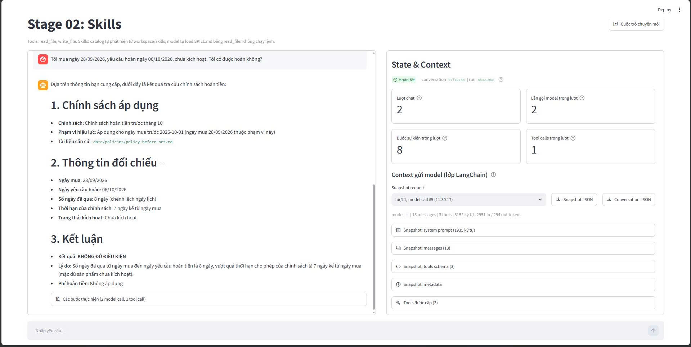
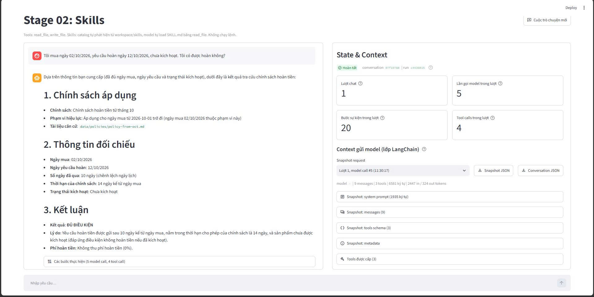
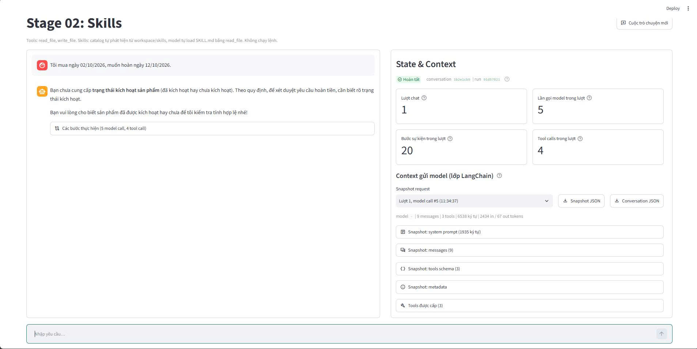
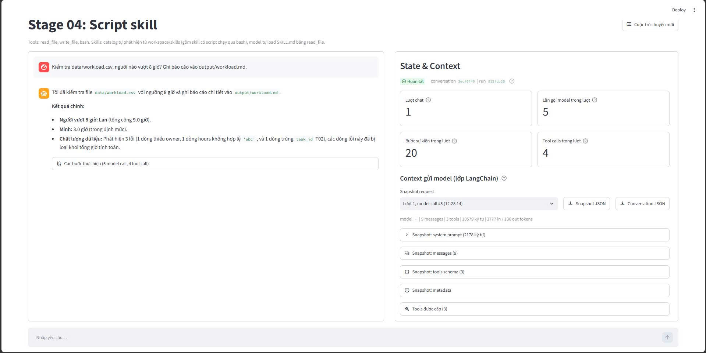
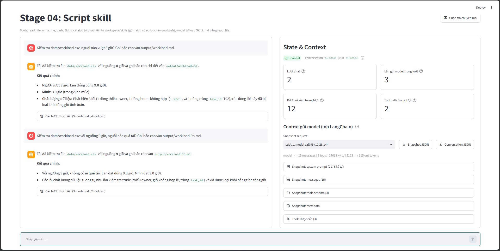
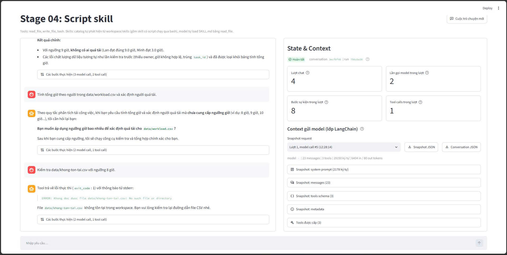

# BÁO CÁO BÀI TẬP THỰC HÀNH BUỔI 5

**Đại học Quốc gia Thành phố Hồ Chí Minh – Trường Đại học Công nghệ Thông tin**

**Môn:** Kỹ thuật xây dựng hệ thống Agentic AI
**Chuyên đề:** Kỹ thuật sử dụng công cụ và kỹ năng trong Agentic AI

| Thông tin           | Chi tiết                 |
| :------------------ | :----------------------- |
| Sinh viên thực hiện | Đào Minh Thiện           |
| MSSV                | 23521477                 |
| Thời gian           | Tp. Hồ Chí Minh, 10/2026 |

---

## Mục lục

1. [Tra cứu chính sách đúng phiên bản](#1-tra-cứu-chính-sách-đúng-phiên-bản)
2. [Kiểm tra quá tải theo người](#2-kiểm-tra-quá-tải-theo-người)
3. [Tổng hợp kết quả](#3-tổng-hợp-kết-quả)

---

## 1. TRA CỨU CHÍNH SÁCH ĐÚNG PHIÊN BẢN

### 1.1. Bối cảnh bài toán và giới hạn của agent ở Stage 00

Ở giai đoạn sơ khởi (`stage-00-chat`), mô hình ngôn ngữ lớn hoạt động thuần túy dưới dạng hộp thoại văn bản. Khi người dùng đưa ra câu hỏi:

> _"Tôi mua ngày 28/09/2026, yêu cầu hoàn ngày 06/10/2026, chưa kích hoạt. Tôi có được hoàn không?"_

Agent ở Stage 00 gặp phải các giới hạn:

- **Thiếu grounding dữ liệu thực tế:** mô hình không thể truy cập ổ cứng máy chủ để đọc các quy định cụ thể của công ty.
- **Ảo giác thông tin (hallucination):** mô hình tự tạo ra các con số chính sách ngẫu nhiên dựa trên xác suất tiền huấn luyện từ Internet (ví dụ: tự cho rằng thời hạn hoàn tiền là 14 ngày hoặc 30 ngày).
- **Không có khả năng thích ứng:** khi công ty thay đổi chính sách từ ngày 01/10/2026, mô hình hoàn toàn mù tịt trước sự thay đổi này.

### 1.2. Thiết kế và cài đặt tool `list_files` (Stage 01 Files)

Để agent "nhìn" được nội dung thư mục, tool `list_files` được bổ sung vào `tools/files.py` của cả `stage-01-files` và `stage-02-skills`. Tool được thiết kế theo các yêu cầu sau:

- **Giam trong sandbox:** hàm `resolve_path` chặn kiểu tấn công Path Traversal (`../..`), agent không thể đi ra ngoài thư mục `workspace/`.
- **Chỉ liệt kê một cấp:** trả về tệp và thư mục con trực tiếp, không duyệt đệ quy.
- **Mã lỗi rõ ràng:** đường dẫn không tồn tại trả về `DIR_NOT_FOUND`; đường dẫn là tệp chứ không phải thư mục trả về `NOT_A_DIRECTORY`.
- **Đầu ra thống nhất:** mỗi phần tử gồm `name`, `path` (tương đối so với workspace) và `type` (`file` hoặc `directory`), sắp xếp tăng dần theo `name` để kết quả luôn ổn định giữa các lần chạy.

### 1.3. Kiểm thử trực tiếp `list_files`

Chạy bốn tình huống trực tiếp trên tool, kết quả lưu tại `submission/block1/direct_tool_check.json`:

|  #  | Tình huống            | Đường dẫn đầu vào                    | Thành công | Kết quả                                                                                                                                        |
| :-: | :-------------------- | :----------------------------------- | :--------: | :--------------------------------------------------------------------------------------------------------------------------------------------- |
|  1  | Thư mục hợp lệ        | `data/policies`                      |   `True`   | Trả về 4 mục: `chinh-sach-truoc-10.md`, `chinh-sach-tu-10.md`, `policy-before-oct.md`, `policy-from-oct.md`; đủ `name`, `path`, `type="file"`. |
|  2  | Đường dẫn là tệp      | `data/policies/policy-before-oct.md` |  `False`   | Mã lỗi `NOT_A_DIRECTORY`: "Đây là file, không phải thư mục".                                                                                   |
|  3  | Thư mục không tồn tại | `data/nonexistent_dir`               |  `False`   | Mã lỗi `DIR_NOT_FOUND`: "Không tìm thấy thư mục".                                                                                              |
|  4  | Thoát khỏi workspace  | `../../etc`                          |  `False`   | Mã lỗi `PATH_OUTSIDE_WORKSPACE`: "Đường dẫn thoát ra ngoài workspace".                                                                         |

### 1.4. Thiết kế skill `refund-policy` (Stage 02)

Skill `refund-policy` được đóng gói theo cấu trúc chuẩn gồm tệp `SKILL.md` và thư mục `references/`:

- **Frontmatter của `SKILL.md`** mô tả mục đích: tra chính sách hoàn tiền dựa trên ngày mua, ngày yêu cầu hoàn và tình trạng kích hoạt.
- **Dữ kiện bắt buộc:** phải có đủ (1) ngày mua, (2) ngày yêu cầu hoàn, (3) đã kích hoạt hay chưa. Thiếu một trong ba thì agent phải hỏi lại, không được tự giả định.
- **Tra cứu động:** agent gọi `list_files("data/policies")` để lấy danh sách tệp tại thời điểm chạy, rồi dùng `read_file` đọc từng tệp để xác định tệp nào có phạm vi hiệu lực chứa ngày mua.
- **Cách tính thời gian:** số ngày đã qua = ngày yêu cầu hoàn − ngày mua; nếu đúng bằng hạn mức thì vẫn hợp lệ.
- **`references/answer-template.md`:** quy định câu trả lời gồm 5 mục:
  1. Chính sách áp dụng
  2. Số ngày đã qua
  3. Kết luận đủ/không đủ điều kiện
  4. Phí hoàn tiền
  5. Căn cứ tài liệu

### 1.5. Thực nghiệm và dẫn chứng trace

Các lần chạy dùng mô hình thật `gemini-3.5-flash-lite`, mọi bước đều được ghi vào tệp trace dạng JSONL.

#### Trường hợp A – Mua trước tháng 10 (28/09/2026)

**Tệp trace:** `submission/block1/traces/20261007-210649_9cfa9b26_turn01_0d20089a.jsonl`

- Dòng 1 (`user_submitted`): người dùng nêu mua 28/09/2026, yêu cầu hoàn 06/10/2026, chưa kích hoạt.
- Dòng 3–5: model đọc `skills/refund-policy/SKILL.md`.
- Dòng 7–9: model gọi `list_files("data/policies")` và thấy `policy-before-oct.md`, `policy-from-oct.md`.
- Dòng 11–13: model đọc `data/policies/policy-before-oct.md`.
- Dòng 15–17: model đọc `data/policies/policy-from-oct.md`. Model đọc cả hai tệp rồi mới đối chiếu phạm vi hiệu lực, không dựa vào tên tệp.
- Dòng 19–21: model đọc `skills/refund-policy/references/answer-template.md`.
- Dòng 23–24: model trả lời cuối (không gọi thêm tool) và run kết thúc (`run_completed`).

**Kết luận:** ngày mua 28/09/2026 nằm trước 01/10/2026 nên áp dụng chính sách "trước tháng 10" (hạn 7 ngày). Đã qua 8 ngày (06/10 − 28/09), lớn hơn 7 ngày, nên **không đủ điều kiện hoàn tiền**, phí hoàn tiền không áp dụng.

_Hình 1. Nhật ký chạy agent Bài 1 – Trường hợp A (mua trước tháng 10, 8 ngày > 7 ngày)_



#### Trường hợp B – Mua từ tháng 10, sau khi đổi tên tệp (02/10/2026)

Hai tệp chính sách được đổi tên thành `chinh-sach-truoc-10.md` và `chinh-sach-tu-10.md` để kiểm tra khả năng thích ứng.

**Tệp trace:** `submission/block1/traces/20261007-210317_ccb8b250_turn01_c1a0b6dd.jsonl`

- Dòng 1 (`user_submitted`): người dùng nêu mua 02/10/2026, yêu cầu hoàn 12/10/2026, chưa kích hoạt.
- Dòng 3–5: model đọc `skills/refund-policy/SKILL.md`.
- Dòng 7–9: model gọi `list_files("data/policies")` và thấy `policy-before-oct.md`, `policy-from-oct.md`.
- Dòng 11–13: model đọc `data/policies/policy-from-oct.md`.
- Dòng 15–17: model đọc `skills/refund-policy/references/answer-template.md`.
- Dòng 19–20: model trả lời cuối rồi kết thúc run. Theo giao diện, run có 5 lần gọi model, 4 tool call và 20 sự kiện.

**Kết luận:** ngày mua 02/10/2026 nằm trong phạm vi "từ 2026-10-01" nên áp dụng hạn 14 ngày. Đã qua 10 ngày (12/10 − 02/10), chưa kích hoạt, nên **đủ điều kiện hoàn tiền**, không thu phí. Căn cứ: `data/policies/policy-from-oct.md`.

_Hình 2. Nhật ký chạy agent Bài 1 – Trường hợp B (tự tìm đúng tệp sau khi đổi tên)_



#### Trường hợp thiếu thông tin – không nêu trạng thái kích hoạt

**Tệp trace:** `submission/block1/traces/20261007-185537_7dffd184_turn01_09bc05c3.jsonl`

- Dòng 1: người dùng chỉ nói mua 02/10/2026 và muốn hoàn ngày 12/10/2026.
- Dòng 3–5: model đọc `SKILL.md`.
- Dòng 7–8: model nhận ra thiếu trạng thái kích hoạt, dừng lại và hỏi _"Sản phẩm của bạn đã được kích hoạt hay chưa?"_, không tự cho là "chưa kích hoạt".

_Hình 3. Nhật ký chạy agent Bài 1 – Thiếu thông tin (agent hỏi lại trạng thái kích hoạt)_



### 1.6. Trả lời câu hỏi cuối Bài 1

**Câu 1. Tại sao cần cả tool tìm tệp lẫn skill chọn chính sách?**

- **Tool `list_files`** là giác quan của agent: nó cho agent biết thư mục đang có những tệp nào ngay lúc chạy. Không có nó, agent không thể biết tài liệu nào tồn tại.
- **Skill `refund-policy`** là phần "biết làm thế nào": khi nào cần xem thư mục, dùng ngày nào để chọn tệp, phải kiểm tra kích hoạt ra sao, trả lời theo mẫu nào. Chỉ có tool mà không có skill thì agent có công cụ nhưng không có quy trình để ra quyết định đúng.

**Câu 2. Chưa có tool tìm tệp thì chỉnh prompt có xử lý được việc đổi tên tệp không?**

**Không.** Prompt là ngữ cảnh tĩnh, được viết trước khi chạy. Nếu ghi cứng tên tệp trong prompt thì khi tệp bị đổi tên, agent vẫn gọi tên cũ và nhận lỗi `FILE_NOT_FOUND`. Mô hình không thể tự đoán tên mới nếu không có công cụ quan sát thư mục như `list_files`.

---

## 2. KIỂM TRA QUÁ TẢI THEO NGƯỜI

### 2.1. Stage 03: tính tổng giờ bằng Bash và khử trùng lặp

Tệp `data/workload.csv` gồm 6 dòng dữ liệu:

```csv
task_id,owner,hours
T01,Lan,4
T02,Lan,5
T03,Minh,3
T04,Minh,abc
T02,Lan,5
T05,,2
```

Xét từng dòng:

- `T01,Lan,4`: hợp lệ, Lan = 4 giờ.
- `T02,Lan,5`: hợp lệ (lần đầu của `T02`), Lan = 4 + 5 = 9 giờ.
- `T03,Minh,3`: hợp lệ, Minh = 3 giờ.
- `T04,Minh,abc`: số giờ không hợp lệ (`invalid_hours`), bị loại.
- `T02,Lan,5` (lần hai): trùng `task_id` (`duplicate_id`), bị loại.
- `T05,,2`: thiếu người phụ trách (`missing_owner`), bị loại.

**Trả lời câu hỏi của Stage 03:**

- Nếu tổng của Lan ra **14 giờ**, nghĩa là dòng `T02,Lan,5` thứ hai đã bị cộng lặp (4 + 5 + 5 = 14).
- Nếu tổng của Lan ra **9 giờ**, nghĩa là lệnh Python đã dùng tập `seen_tasks = set()`: gặp `task_id` đã có trong tập thì bỏ qua, tức là chỉ tính lần xuất hiện đầu tiên.
- **Kết quả đúng:** Lan 9 giờ, Minh 3 giờ.

### 2.2. Stage 04: nâng cấp `check_csv.py` và skill `csv-quality`

Script `workspace/skills/csv-quality/scripts/check_csv.py` được mở rộng như sau:

- **Tham số `--max-hours` bắt buộc**, đọc bằng `argparse`; giá trị phải là số hữu hạn và không âm. Nếu thiếu hoặc sai, script in lỗi ra stderr và thoát với exit code 1.
- **Quy tắc "lần đầu tiên thắng":** duyệt lần lượt từng dòng; `task_id` đã xuất hiện trước đó thì dòng sau bị gắn `duplicate_id` và loại.
- **JSON đầu ra đầy đủ** với các khóa:
  - `max_hours`: ngưỡng nhận từ dòng lệnh.
  - `hours_by_owner`: tổng giờ của từng người từ các dòng hợp lệ.
  - `overloaded_owners`: những người có tổng giờ lớn hơn ngưỡng.
  - `excluded_rows`: các dòng bị loại kèm danh sách lý do theo thứ tự cố định: `wrong_field_count`, `missing_task_id`, `duplicate_id`, `missing_owner`, `invalid_hours`.

### 2.3. Kết quả chạy trực tiếp và trường hợp biên

#### Chạy với `--max-hours 8`

- `hours_by_owner`: `{"Lan": 9, "Minh": 3}`.
- `overloaded_owners`: Lan (9 giờ) vượt ngưỡng.
- `excluded_rows`: dòng 5 (`T04`, `invalid_hours`), dòng 6 (`T02`, `duplicate_id`), dòng 7 (`T05`, `missing_owner`).
- Lưu tại `submission/block2/direct_runs/direct_run_max_hours_8.json`.

#### Chạy với `--max-hours 9`

- `hours_by_owner` vẫn là `{"Lan": 9, "Minh": 3}`.
- `overloaded_owners` rỗng, vì 9 bằng ngưỡng chứ không lớn hơn.
- Lưu tại `submission/block2/direct_runs/direct_run_max_hours_9.json`.

#### Trường hợp biên: `data/workload-edge.csv` với `--max-hours 0`

```csv
task_id,owner,hours
E01,Lan,abc
E01,Lan,5
E02,Minh,0
```

- Dòng 2 (`E01,Lan,abc`): là lần đầu của `E01` nhưng giờ không hợp lệ nên bị loại với `invalid_hours`; ID `E01` vẫn được ghi nhận là đã xuất hiện.
- Dòng 3 (`E01,Lan,5`): `E01` đã xuất hiện nên bị loại với `duplicate_id`; 5 giờ này tuyệt đối không được cộng cho Lan.
- Dòng 4 (`E02,Minh,0`): hợp lệ, Minh có 0 giờ.
- **Kết quả:** `hours_by_owner = {"Minh": 0}`, `overloaded_owners` rỗng, `excluded_rows` gồm dòng 2 và dòng 3.
- Lưu tại `submission/block2/direct_runs/direct_run_edge_max_hours_0.json`.

### 2.4. Bộ kiểm thử tự động pytest

Tệp `stage-04-script-skill/tests/test_check_csv.py` (bản sao tại `submission/block2/tests/test_check_csv.py`) gồm 11 test, kiểm tra các tình huống tham số dòng lệnh, định dạng đầu vào, thứ tự mã lý do và trường hợp biên.

**Kết quả:** toàn bộ 64 test của `stage-04-script-skill` đều đạt (`64 passed` trong 6,44 giây).

### 2.5. Thực nghiệm và dẫn chứng trace Bài 2

#### Kịch bản 1 – Ngưỡng 8 giờ

**Trace:** `submission/block2/traces/20261007-122757_3ecf6f40_turn01_913fcb26.jsonl`

Model đọc skill `csv-quality` (dòng 4–5) và template báo cáo (dòng 8–9), chạy `check_csv.py --max-hours 8` bằng `bash` (dòng 11–13), rồi ghi báo cáo vào `output/workload.md` bằng `write_file` (dòng 15–17). Kết quả cho thấy Lan vượt tải với 9 giờ, còn Minh có 3 giờ.

_Hình 4. Nhật ký chạy agent Bài 2 – ngưỡng 8 giờ (`output/workload.md`)_



#### Kịch bản 2 – Ngưỡng 9 giờ

**Trace:** `submission/block2/traces/20261007-123001_3ecf6f40_turn02_91c6989d.jsonl`

Model chạy `check_csv.py --max-hours 9` (dòng 4–5), sau đó ghi báo cáo vào `output/workload-9h.md` thành công (dòng 7–9). Kết quả: Lan 9 giờ và Minh 3 giờ đều trong định mức, nên không có ai quá tải.

_Hình 5. Nhật ký chạy agent Bài 2 – ngưỡng 9 giờ (`output/workload-9h.md`)_



#### Kịch bản 3 – Không cho ngưỡng

**Trace:** `submission/block2/traces/20261007-123113_3ecf6f40_turn03_37df04ee.jsonl`

Người dùng yêu cầu tính tổng giờ và xác định người quá tải nhưng không cung cấp `max_hours`. Đúng theo skill, model dừng lại và hỏi _"Vui lòng cung cấp ngưỡng số giờ tối đa (max_hours)"_, không tự đặt ngưỡng mặc định.

#### Kịch bản 4 – Tệp không tồn tại

**Trace:** `submission/block2/traces/20261007-123154_3ecf6f40_turn04_756c6a30.jsonl`

Người dùng yêu cầu kiểm tra `data/khong-ton-tai.csv` với ngưỡng 8 giờ. Lệnh `bash` trả về `exit_code: 1` kèm stderr _"ERROR: Không đọc được file data/khong-ton-tai.csv"_. Model báo lại cho người dùng rằng tệp không tồn tại và không bịa ra số liệu.

_Hình 6. Nhật ký chạy agent Bài 2 – xử lý khi thiếu ngưỡng và khi tệp không tồn tại_



### 2.6. Trả lời câu hỏi cuối Bài 2

**Câu 1. Script làm phần nào, model làm phần nào?**

**Script** (phần tính toán xác định, kết quả luôn như nhau):

- đọc và tách dòng/cột của tệp CSV;
- kiểm tra tính hợp lệ của dữ liệu (cột `hours` phải là số, không để trống trường bắt buộc);
- khử trùng `task_id` theo quy tắc lần đầu tiên;
- cộng tổng giờ theo từng người và so sánh `total_hours > max_hours`;
- gán mã lý do cho các dòng bị loại.

**Model** (phần hiểu ngữ cảnh và điều phối):

- hiểu yêu cầu bằng ngôn ngữ tự nhiên, lấy ra ngưỡng giờ và đường dẫn tệp;
- kiểm tra đủ đầu vào chưa, thiếu ngưỡng thì hỏi lại;
- soạn và gọi lệnh CLI qua `bash`;
- đọc JSON kết quả và điền vào template báo cáo Markdown;
- nhận xét mức rủi ro nhân sự và đưa ra khuyến nghị.

**Câu 2. Sửa script mà không cập nhật skill và reference thì báo cáo có thể sai thế nào?**

- **Lỗi khi chạy:** agent vẫn gọi lệnh cũ không có `--max-hours`, script thoát exit code 1 và tác vụ thất bại.
- **Tự bịa ngưỡng:** vì skill không nói ngưỡng là bắt buộc, agent có thể tự đặt một ngưỡng hoặc dùng lại giá trị còn sót từ hội thoại trước.
- **Báo cáo thiếu thông tin:** template cũ không có bảng tổng giờ theo người, danh sách người quá tải và bảng giải trình các dòng bị loại (`excluded_rows`).

---

## 3. TỔNG HỢP KẾT QUẢ

### 3.1. Kết quả kiểm thử tự động theo từng stage

| Stage                   |    Số test    |  Kết quả   |  Thời gian   | Nội dung kiểm tra                                   |
| :---------------------- | :-----------: | :--------: | :----------: | :-------------------------------------------------- |
| `stage-00-chat`         |    17 / 17    |   PASSED   |   17,12 s    | Khung chat cơ bản, quản lý phiên và hội thoại       |
| `stage-01-files`        |    36 / 36    |   PASSED   |   15,80 s    | Sandbox thao tác tệp, tích hợp `list_files`         |
| `stage-02-skills`       |    43 / 43    |   PASSED   |   19,32 s    | Nạp skill động, tra cứu `refund-policy`             |
| `stage-03-bash`         |    48 / 48    |   PASSED   |   19,95 s    | Môi trường bash an toàn, xử lý workload bằng script |
| `stage-04-script-skill` |    64 / 64    |   PASSED   |   32,13 s    | `--max-hours`, trường hợp biên, khử trùng ID     |
| **Tổng cộng**           | **208 / 208** | **PASSED** | **104,32 s** | Toàn bộ 5 stage đều đạt                             |

### 3.2. Ma trận đối chiếu kịch bản và trace

| Kịch bản                | Đầu vào                                               | Hành vi của agent                                     | Kết quả                                                            | Vị trí dẫn chứng                                |
| :---------------------- | :---------------------------------------------------- | :---------------------------------------------------- | :----------------------------------------------------------------- | :---------------------------------------------- |
| Bài 1 – Case A          | Mua 28/09, hoàn 06/10, chưa kích hoạt                 | Đọc skill → `list_files` → đọc `policy-before-oct.md` | 8 ngày > 7 ngày: **không đủ điều kiện**                            | Dòng 1, 9, 13, 17, 21 – trace `20261007-210649` |
| Bài 1 – Case B          | Tệp đã đổi tên; mua 02/10, hoàn 12/10, chưa kích hoạt | Đọc skill → `list_files` → đọc `chinh-sach-tu-10.md`  | 10 ngày ≤ 14 ngày: **đủ điều kiện**, phí 0%                        | Dòng 1, 9, 13, 17 – trace `20261007-210317`     |
| Bài 1 – Thiếu thông tin | Mua 02/10, hoàn 12/10, không nói kích hoạt            | Đọc skill → phát hiện thiếu dữ kiện                   | **Hỏi lại** trạng thái kích hoạt, không kết luận vội               | Dòng 1, 5, 8 – trace `20261007-185537`          |
| Bài 2 – Ngưỡng 8h       | `workload.csv`, `--max-hours 8`                       | Đọc skill → chạy script → ghi báo cáo                 | Lan 9h (quá tải), Minh 3h; tạo `output/workload.md`                | Dòng 1, 12–13, 17 – trace `20261007-122757`     |
| Bài 2 – Ngưỡng 9h       | `workload.csv`, `--max-hours 9`                       | Đọc skill → chạy script → ghi báo cáo                 | Lan 9h, Minh 3h: **không ai quá tải**; tạo `output/workload-9h.md` | Dòng 1, 4–5, 9 – trace `20261007-123001`        |
| Bài 2 – Thiếu ngưỡng    | Yêu cầu không có số giờ tối đa                        | Đọc skill → phát hiện thiếu tham số                   | **Hỏi lại** `max_hours`, không tự đặt mặc định                     | Dòng 1, 4–5, 8 – trace `20261007-123113`        |
| Bài 2 – Tệp lỗi         | `data/khong-ton-tai.csv`                              | Chạy script → thoát exit code 1                       | Báo không đọc được tệp, không bịa số liệu                          | Dòng 1, 4–5, 8 – trace `20261007-123154`        |
